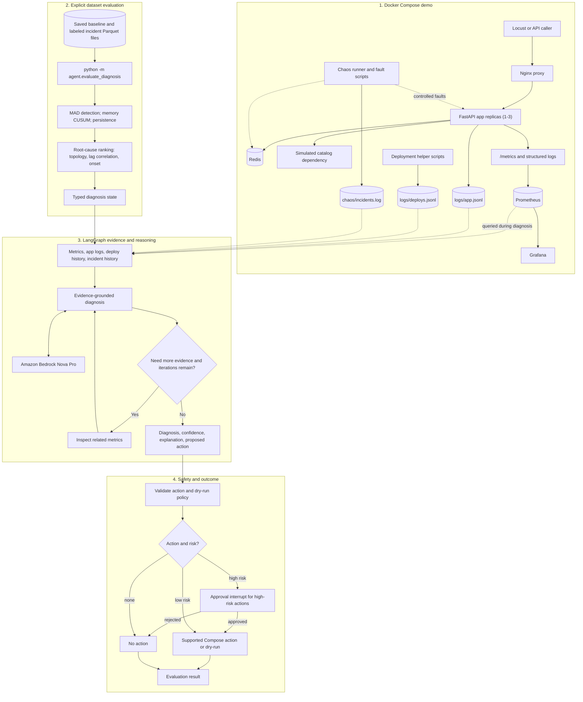
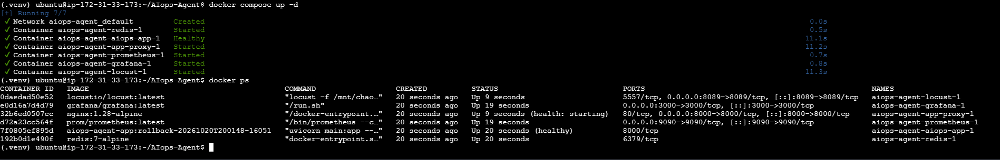
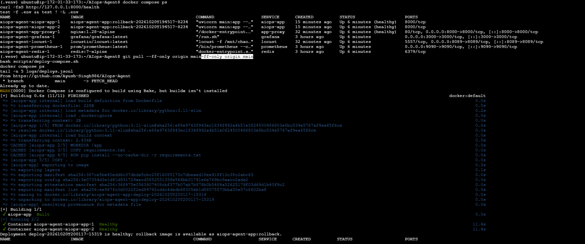
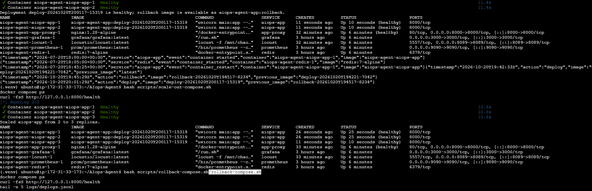
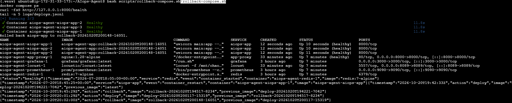

# AIOps Project: Interview and Deployment Guide

This guide explains the project in plain English, gives you a presentation you can use in an interview, and walks through deploying the demo stack on a Linux server.

This is the complete project and deployment guide. The [README.md](./README.md) is the short overview and links back here for the end-to-end explanation, interview material, evaluation details, and deployment instructions.

## 1. The real-world problem

When an online service slows down or stops working, users notice it before the engineering team knows why. A dashboard may show high response times, errors, or an outage, but those are symptoms. The actual cause could be the application, its cache, a downstream service, or a resource such as CPU or memory.

Engineers often have to:

1. Notice and acknowledge an alert.
2. Open several dashboards and log sources.
3. Work out which metric changed first and which changes are related.
4. Decide whether a proposed fix is safe.
5. Apply the fix and check that the service recovered.

That investigation can take time, especially when several metrics change together. Automatically restarting or changing services without checks can also make an incident worse.

## 2. The solution, in simple terms

This project is a small, chaos-testable AIOps incident-response prototype. It collects service metrics, detects unusual behavior, ranks likely root causes, and uses an LLM to explain or challenge that ranking using evidence. It can then recommend a limited remediation action. Higher-risk actions are designed to require human approval.

The key design choice is to keep the quantitative diagnosis outside the LLM. Statistical code detects anomalies and creates a ranked list first. The LLM receives those candidates and supporting evidence; it is not asked to discover a root cause from unfiltered telemetry.

### Interview-ready introduction (about one minute)

> “I built an AIOps incident diagnosis prototype to reduce the time engineers spend finding the cause of service incidents. The demo runs a FastAPI service with Redis and monitors it using Prometheus. I can inject controlled failures such as Redis latency, downstream failures, CPU spikes, and memory growth.
>
> The detector uses rolling median and MAD-based scores for sudden changes, CUSUM for gradual memory growth, and a persistence check to avoid reacting to a single noisy sample. When several metrics are abnormal, a separate correlation stage ranks possible causes using a dependency map, lagged correlation, and onset timing.
>
> A LangGraph workflow then gathers metric, application-log, deployment, and incident-history evidence. An LLM explains the diagnosis and can challenge the statistical ranking, but it is constrained to the evidence and a fixed action set. The workflow routes higher-risk actions through an approval step.
>
> I evaluated it using faults that I injected myself, so the expected fault type was known. On this small dataset, root-cause accuracy improved from 70% for the statistical ranking to 80% with the LLM reasoning layer. I treat those figures as indicative, not a production guarantee. The current repository is a prototype: Compose deploys the demo and monitoring stack, while diagnosis is run separately rather than as a continuously running production service.”

## 3. How a diagnosis flows from start to finish

1. **The service emits telemetry.** The FastAPI app exposes Prometheus metrics at `/metrics/`. It tracks request count and latency, and the service also exposes application, Redis, downstream, CPU, and memory metrics.
2. **Prometheus scrapes the app.** The Compose configuration scrapes every five seconds and retains its data in a Docker volume.
3. **A fault is injected for testing.** The chaos scripts can introduce Redis or downstream latency, failures, an app outage, CPU load, or memory growth. They record the fault and its timing so an evaluation can compare the diagnosis with the known cause.
4. **The detector flags unusual metrics.** Most metrics use a modified z-score based on a rolling median and median absolute deviation (MAD). Memory uses an upward CUSUM path because a leak is a gradual drift, not necessarily a single spike. A persistence filter requires repeated abnormal samples before flagging a metric.
5. **The root-cause stage ranks candidates.** A hand-maintained dependency map encodes plausible cause-and-effect relationships. The ranking combines the dependency prior, lagged correlation, and onset timing. A detected app-availability outage is treated as a hard outage signal.
6. **The diagnosis workflow gathers context.** LangGraph nodes collect metric summaries, application-log samples, nearby deployment records, and similar recorded incidents. If the first diagnosis is uncertain, the workflow investigates related metrics and tries again, with an iteration limit.
7. **The LLM explains or challenges the ranking.** Amazon Bedrock Nova Pro is the configured provider. The prompt asks it to use the provided evidence, explain its choice, and select from a fixed set of remediation actions. Its confidence is bounded by the statistical candidate confidence.
8. **The workflow applies a safety route.** The workflow can finish without action, execute a low-risk action, or pause at an approval interrupt for an action classified as high risk. Scale-out and deployment rollback require approval.
9. **The result can be checked.** The diagnosis report includes the selected root cause, confidence, hypothesis, action, approval status, and remediation result.

For this Compose demo, an Nginx proxy routes requests to the app so Compose can add replicas without binding every replica to the same host port. Prometheus discovers and scrapes each replica through Docker DNS. The approved `scale_out` action adds one replica, up to three total. The approved `rollback_deploy` action restores the prior image saved by `scripts/deploy-compose.sh`; it is available only after that deployment helper has been used.

### What runs automatically, and what does not

`docker compose up` starts the FastAPI app, Redis, Prometheus, Grafana, and Locust. It does **not** start a background detector or a continuously listening diagnosis agent. The evaluation and diagnosis entry points are Python commands run separately from the repository root. The full diagnosis evaluation uses the checked-in baseline and incident datasets and queries the local Prometheus service for evidence; it is not a production event consumer.

## 4. Main project areas

| Path | Purpose |
|---|---|
| [service/](./service/) | FastAPI application, metrics, logging, and chaos-control endpoints |
| [chaos/](./chaos/) | Fault injection and experiment runners |
| [detector/](./detector/) | MAD and forecast-residual detectors, Prometheus queries, evaluation, and root-cause ranking |
| [agent/](./agent/) | LangGraph diagnosis workflow, evidence nodes, LLM calls, and remediation routing |
| [data/](./data/) | Baseline telemetry and labeled incident datasets used for evaluation |
| [prometheus/prometheus.yml](./prometheus/prometheus.yml) | Prometheus scrape configuration |
| [docker-compose.yml](./docker-compose.yml) | Demo application and observability stack |

## 5. Interview questions and example answers

### Basic

**Q: What problem does the project solve?**  
**A:** It helps shorten incident investigation by detecting abnormal service metrics, ranking likely causes, and collecting evidence in one diagnosis workflow. It also puts approval checks between a diagnosis and higher-risk remediation.

**Q: What does AIOps mean here?**  
**A:** Applying operational data and automation to incident detection and response. In this project, that means telemetry-based anomaly detection, root-cause ranking, evidence-based diagnosis, and guarded remediation recommendations.

**Q: What technologies did you use?**  
**A:** Python, FastAPI, Redis, Prometheus, Grafana, Docker Compose, pandas and NumPy, LangGraph, and Amazon Bedrock.

**Q: What can the demo monitor or inject?**  
**A:** It tracks request rate, application latency and errors, Redis and downstream latency/errors, CPU, memory, and application availability. The experiment runner supports Redis latency/outage, app outage, downstream latency/failure, CPU spike, and memory leak faults.

### Intermediate

**Q: Why use median and MAD instead of mean and standard deviation?**  
**A:** Median and MAD are more resistant to a few extreme observations. That makes the rolling baseline less likely to be distorted by the very spikes the detector is trying to find. Thresholds and windows are configured per metric because their normal behavior differs.

**Q: Why does the detector require repeated abnormal samples?**  
**A:** A persistence filter reduces alerts caused by one noisy scrape. It trades faster detection for fewer transient alerts. With 30-second evaluation samples, three consecutive flagged points represent roughly 90 seconds of sustained deviation.

**Q: Why is memory handled differently?**  
**A:** A memory leak can appear as a slow, persistent rise rather than a sharp point anomaly. The one-sided CUSUM accumulates repeated upward deviations, making it better suited to that pattern in this prototype.

**Q: How does the system distinguish a cause from a symptom?**  
**A:** It uses a dependency prior to encode plausible direction, lagged correlation to see whether metrics move together with a time offset, and onset timing as one additional signal. The score is `0.5 × prior + 0.35 × correlation + 0.15 × onset timing`. This is a ranking heuristic, not proof of causation.

**Q: Why use an LLM after the statistical pipeline?**  
**A:** The detector and correlation stages are explainable and repeatable for numerical analysis. The LLM is used for evidence-grounded comparison and a readable explanation, not as the first or only detector. This also limits the chance of the LLM inventing a cause from raw telemetry.

**Q: What does LangGraph contribute?**  
**A:** It represents diagnosis as an explicit stateful workflow: gather evidence, diagnose, check confidence, optionally gather more evidence, finalize the action, and route through approval or execution.

**Q: How did you evaluate root-cause accuracy?**  
**A:** I injected faults whose type and timing were known, then compared the predicted root metric with that ground truth. The methodology reports 70% for the statistical pipeline and 80% after LLM reasoning on about 10–11 incidents. That dataset is too small to claim production accuracy.

### Advanced

**Q: Does correlation establish that one metric caused another?**  
**A:** No. Correlation and earlier onset are supporting signals, not causal proof. The dependency map narrows the candidates, but it is manually encoded and limited to this demo architecture. Production diagnosis should use stronger evidence such as distributed traces, service topology, and validated incident history.

**Q: What are the main limitations?**  
**A:** The evaluation set is small and self-injected; the current baseline is not seasonality-aware; the dependency map is hand-maintained; deployment and incident history are local demo logs; and there is no always-on detector/agent service. The project also has a known ambiguous CPU-spike case documented in the methodology.

**Q: Is it ready to remediate a production system autonomously?**  
**A:** No. It is a prototype. In the Compose demo, scale-out is limited to three app replicas on one host, and rollback restores a prior image recorded by the deployment helper. Both are high-risk actions that pause for approval in an interactive graph run. The evaluator auto-approves interrupts, so remediation defaults to dry-run and I never run the evaluator with live remediation enabled. Production use would require platform-native scaling, authenticated policy enforcement, durable audit trails, tested deployment integrations, and broader recovery checks.

**Q: How would you improve it for a real environment?**  
**A:** First, make detection seasonal-aware and continuously consume production telemetry. Then derive dependency topology from service catalog or tracing data, integrate real deployment and incident systems, and build a larger labeled evaluation set from reviewed postmortems. I would also add authentication and authorization, structured audit logs, per-action policies, idempotency, rollback plans, and human approval for high-impact changes.

**Q: What happens if the LLM returns malformed output?**  
**A:** The diagnosis code handles a JSON parse failure by setting confidence to zero, requesting more evidence, and selecting no remediation action. The workflow has an iteration limit. Other infrastructure failures, such as unavailable Bedrock credentials or Prometheus, should be monitored and handled explicitly before production use.

**Q: What would you monitor about the AIOps system itself?**  
**A:** Detection latency, alert precision/recall, diagnosis accuracy after human review, confidence calibration, evidence-source availability, LLM latency/errors/cost, approval and rejection rates, remediation success, recovery time, and any unintended side effects.

## 6. Technical deep dive, evaluation, and project evidence

This section brings the architecture, statistical methodology, evaluation output, screenshots, and future-work priorities together so this guide can be used on its own.

### Architecture at a glance



**Important:** the Compose services and metrics can be live, but the current evaluation begins from saved Parquet telemetry. The graph may query live Prometheus and local logs for evidence after it starts. Grafana changes do not trigger an evaluation, and there is not yet an always-on alert consumer.

### What the detector measures and how it works

The documented detector tracks nine signals: request rate, application p95 latency, application error rate, Redis average latency, cache error rate, downstream average latency, downstream error rate, process CPU rate, and process resident memory.

For most metrics, the detector uses a rolling modified z-score:

```text
score = 0.6745 * |value - rolling_median| / rolling_MAD
```

The rolling reference is lagged so the current point does not influence its own baseline. Windows and thresholds vary by metric because latency, request rates, and errors have different normal variability. Process memory uses an upward CUSUM path because a leak is gradual drift:

```text
s_pos = max(0, s_pos + z - k)
```

A persistence filter requires three consecutive flagged observations. At the documented 30-second evaluation resolution, that is roughly 90 seconds of sustained deviation. This suppresses transient noise but can miss faults shorter than the persistence window; that is an explicit precision/recall tradeoff.

The documented baseline false-alarm rate was approximately 9–10% of timeline windows (the fraction of 30-second windows with any false alarm across the monitored metrics). This is a prototype-specific measurement, not a target or production guarantee. The detector uses a small lag window for pairwise cross-correlation (±4 samples, or about ±2 minutes at 30-second resolution). Metric-specific windows and thresholds matter because a jittery latency signal should not be treated exactly like an error-rate signal.

### How root-cause candidates are ranked

When multiple signals are abnormal, the candidate score combines:

```text
confidence = 0.5 * dependency_prior
           + 0.35 * lag_correlation
           + 0.15 * onset_timing
```

- **Dependency prior:** a hand-maintained topology encodes which metrics could plausibly explain others. For example, Redis latency could contribute to app latency, but app latency does not explain Redis latency.
- **Lag correlation:** compares co-occurring metric behavior over a small time offset; memory's rate of change is used rather than its steadily rising raw value.
- **Onset timing:** gives weight to when a candidate first changed relative to other anomalous signals.

Application availability is treated as a hard outage signal. A single flagged metric can be the only candidate without a multi-metric ranking. These mechanisms rank hypotheses; they do not establish causation. Confidence is not a calibrated probability.

### What happens inside the LangGraph workflow

The workflow begins with a typed incident state containing the dataset incident window and statistically ranked candidates. Its nodes then:

1. Summarize candidate metric behavior around the incident window using Prometheus.
2. Read relevant application log records.
3. Look for nearby deploy events in the local deployment history.
4. Compare against incident history from the chaos log.
5. Ask the configured Bedrock Nova Pro model to diagnose from the candidates and evidence.
6. If more information is needed, inspect related metrics rather than every possible signal; diagnosis retries are bounded (up to three attempts).
7. Validate the proposed action and route to no-op, dry-run/execution, or a high-risk approval interrupt.

The model is instructed not to invent a cause or treat correlation/onset as proof. Its choice is constrained by the evidence and allowed action set. The documented confidence bound is `min(phase3_confidence + 0.15, llm_confidence)`, so the LLM's stated confidence cannot lift the result arbitrarily above the statistical evidence.

### Remediation boundary and actions

The supported actions are `none`, `flush_cache`, `restart_service`, `scale_out`, and `rollback_deploy`. An action may be rejected or omitted when evidence does not justify it. For example, Redis or downstream latency alone is not sufficient evidence to restart the app.

The higher-risk Compose demonstrations are deliberately narrow:

- `scale_out` adds one FastAPI replica behind Nginx, up to three total, on the same host.
- `rollback_deploy` restores the previously saved image from the deployment helper and requires deployment history.
- In an interactive diagnosis graph, high-risk actions pause for approval.
- `AIOPS_DRY_RUN` defaults to `true`, preventing commands from changing Docker state.
- **The evaluation harness passes `auto_approve=True` and automatically resumes approval interrupts. Always run it with dry-run enabled; its `approved` status does not mean a human approved an action.**
- Directly running the deployment helper scripts is a deliberate operator action and does not show that the diagnosis agent chose or approved that action.

This is not production autoscaling, a production rollback controller, or a safe autonomous controller for real services.

### Latest diagnosis evaluation: exact interpretation

The latest shared run scored ten labeled incidents. An unlabeled `memory_spike` dataset was skipped and is not included. Results:

| Incident | Expected root cause | Statistical candidate | Final diagnosis | Result |
|---|---|---|---|---|
| `cpu_spike_52dcb84f` | `process_cpu_rate` | `downstream_average_latency_seconds` | `redis_average_latency_seconds` | Incorrect |
| `downstream_failure_fd739d70` | `downstream_error_rate` | `downstream_error_rate` | `downstream_error_rate` | Correct |
| `downstream_latency_a00e71c7` | `downstream_average_latency_seconds` | `downstream_average_latency_seconds` | `downstream_average_latency_seconds` | Correct |
| `app_outage_9fc6ee70` | `app_availability` | `app_availability` | `app_availability` | Correct |
| `downstream_latency_f222e70b` | `downstream_average_latency_seconds` | `downstream_average_latency_seconds` | `downstream_average_latency_seconds` | Correct |
| `downstream_latency_fdc80266` | `downstream_average_latency_seconds` | `process_resident_memory_bytes` | `downstream_average_latency_seconds` | Correct; LLM override |
| `memory_leak_35c25d43` | `process_resident_memory_bytes` | `downstream_average_latency_seconds` | `downstream_average_latency_seconds` | Incorrect |
| `redis_latency_b50614d5` | `redis_average_latency_seconds` | `redis_average_latency_seconds` | `redis_average_latency_seconds` | Correct |
| `redis_outage_5742c596` | `redis_average_latency_seconds` | `redis_average_latency_seconds` | `redis_average_latency_seconds` | Correct |
| `redis_outage_8db2dfbc` | `redis_average_latency_seconds` | `redis_average_latency_seconds` | `redis_average_latency_seconds` | Correct |

| Measure | Latest shared run |
|---|---:|
| Statistical pipeline accuracy | 70% (7/10) |
| Statistical pipeline plus LLM accuracy | 80% (8/10) |
| Agreement with statistical candidate | 80% (8/10) |
| Average confidence score | 0.572 |
| LLM overrides / correct overrides | 2 / 1 |
| Evidence escalation | 4/10 incidents |
| Average diagnosis iterations | 1.70 |
| Cases reaching the three-iteration limit | 3/10 |

The CPU-spike case was mistaken for Redis latency. The memory-leak case was mistaken for downstream latency. In the `downstream_latency_fdc80266` case, Phase 3 favored process memory based on onset, while stronger downstream correlation helped the LLM choose the correct cause. These are meaningful examples of both an override and a remaining failure.

Ten labeled cases are a very small sample; one case moves accuracy by ten percentage points. The 80% result is not a production guarantee. Older screenshots and notes describe earlier runs with different iteration/escalation values, and one earlier run executed a restart. For the latest output, use the figures in the table above: it ran with `AIOPS_DRY_RUN=true`, and the app-outage restart was a dry-run rather than a live restart.

The evaluation command is:

```bash
AIOPS_DRY_RUN=true python -m agent.evaluate_diagnosis
```

It also requires the Python agent dependencies, local Prometheus, a configured `LOG_FILE`, and AWS Bedrock access. The root-cause-only command does not call the LLM or invoke remediation:

```bash
python -m detector.evaluate_rootcause
```

### Monitoring, metrics, and deployment evidence

Prometheus scrapes the app every five seconds. One documented `/metrics` capture showed, for that process at that moment, 111 successful item reads, 20 successful item writes, 57 health checks, 111 cache hits, 111 successful simulated catalog calls, and approximate average latencies of 6.62 ms for item GET requests, 0.86 ms for health checks, 1.57 ms for item POST requests, 0.43 ms for Redis GETs, 0.45 ms for Redis SETs, and 5.29 ms for downstream calls. Those are cumulative process counters from one snapshot—not a time-window or cluster-wide performance report. The capture also included one earlier root-path 404, before the root information route was added.

The Locust screenshots show a one-user test at about 0.8 requests per second with no failures at the captured moment, plus response-time percentiles with brief spikes around 500 ms. These observations do not identify the cause of a spike by themselves; correlate their timestamps with metrics, logs, and experiment records.

The EC2 screenshots document a separate, operator-driven Compose deployment exercise:

- 
- 
- 
- 
- 
- 
- 
- 
- 

The deployment screenshots show the app progressing to healthy, a helper-driven deployment preserving the replica count, scale-out from two to three replicas, and rollback to the saved image while retaining three healthy replicas. These steps were not triggered by the evaluator. A public-IP curl command shown in an earlier transcript had a duplicated `http://` and is invalid; the valid health check was against `127.0.0.1` on the EC2 host. Terraform intentionally has no inbound security-group rules, so use SSM port forwarding rather than opening the demo ports to the internet.

### Detailed code map

| Directory/file | Responsibility |
|---|---|
| `service/main.py`, `service/routes.py` | FastAPI setup, request handlers, Redis/downstream behavior, health and metrics endpoints |
| `service/chaos_routes.py`, `service/chaos_state.py` | Demo fault-control endpoints and active fault state |
| `service/metrics.py`, `service/logger.py` | Prometheus metric definitions and structured app logs |
| `chaos/run_experiments.py`, `chaos/scripts/` | Fault experiment runner and individual fault scenarios |
| `chaos/incident_logger.py` | Records known injected incident metadata and timing |
| `detector/mad_detector.py`, `detector/forecast_detector.py` | Anomaly scoring, including MAD and additional residual detection |
| `detector/metric_queries.py`, `detector/prometheus_api.py` | Prometheus query definitions and retrieval |
| `detector/evaluate.py`, `detector/evaluate_rootcause.py` | Detection and statistical root-cause evaluation |
| `detector/rootcause/analysis.py`, `detector/rootcause/topology.py` | Candidate ranking and dependency priors |
| `agent/build_state.py`, `agent/state.py` | Typed incident state construction and definition |
| `agent/graph.py`, `agent/tool_nodes.py` | LangGraph execution, evidence tools, escalation, and approval interrupts |
| `agent/diagnosis.py`, `agent/llm.py`, `agent/utils.py` | Prompting, model calls, confidence logic, and evidence utilities |
| `agent/remediation.py` | Allowed-action validation, dry-run, and action execution |
| `agent/evaluate_diagnosis.py` | Full diagnosis evaluator |
| `data/` | Baseline telemetry and labeled incident Parquet files |
| `logs/` | Local application and deployment JSONL records |
| `scripts/` | Environment setup and Compose deploy, scale, and rollback helpers |
| `terraform/` | Low-cost single-EC2 demo infrastructure with SSM access |

### Production-readiness priorities

The project is currently a lab prototype. A sensible next sequence is:

1. **Safety and reliability:** validate model output against typed schemas; make tool/model failures visible; test approval, action allowlists, dry-run, and remediation failure paths; add structured decision audit records.
2. **Evaluation quality:** increase labeled incidents and fault variations; track precision/recall, detection delay, top-k root-cause accuracy, confidence calibration, and unsafe-action rate; record dataset/model/config versions for reproducibility.
3. **Better signals and topology:** add seasonality-aware baselines, missing/stale telemetry checks, and dependency evidence from distributed traces or a service catalog rather than a hand-maintained table.
4. **Real operational evidence:** replace local self-logged deployment and incident history with scoped read-only CI/CD and incident-management integrations.
5. **Production deployment and controls:** define the threat model; add authentication, authorization, durable audit, backups, recovery testing, resource limits, and platform-native scaling/rollback. Keep fault injection isolated from production.

These are future improvements, not features the current project claims to have completed.

## 7. Deploy the demo stack on an Ubuntu server

These steps deploy the **demo infrastructure**. They do not turn the repository into a production-grade, always-on AIOps platform. Run chaos experiments only on an isolated test server: some experiments stop or stress the application.

### Choose the deployment path before Step 1

Terraform is an **alternative way to create a new AWS server**, not a step to run after the manual setup below:

| Your situation | What to do |
|---|---|
| You already created an EC2/Ubuntu server and are following manual Steps 1–7 below | Continue on that server. You do not need Terraform for this deployment. |
| You want Terraform to create and configure a new AWS server | Use the [Terraform alternative](#10-alternative-deployment-provision-a-new-aws-server-with-terraform) **instead of** manual Steps 1–4. Terraform installs Docker, clones the project, creates the Grafana `.env`, and starts Compose for you. Then use its Systems Manager and dashboard-access steps. |
| You already completed manual Steps 1–7 and now want to use Terraform | Do not apply Terraform to the existing server: this configuration creates a **separate EC2 instance**, which may incur additional charges. Use Terraform only if you intentionally want a second/new server or plan to migrate and later remove the manually provisioned one. |

In short, the Terraform route is **Terraform apply → automatic server setup → Systems Manager access → verify/use the running stack → Terraform destroy when finished**. It replaces the manual server creation/setup steps; it is not required to run the application you have already deployed.

### Before you begin

- An Ubuntu 22.04/24.04 server with outbound internet access.
- A non-root account with `sudo`.
- A Git repository URL and permission to clone it.
- Enough disk for Docker images and Prometheus/Grafana data.
- If you plan to run the Bedrock-backed diagnosis agent: AWS credentials supplied securely, Bedrock model access in the configured AWS region, and permission to invoke the selected model.

Do not expose the demo ports directly to the public internet. The Compose file publishes the app, Prometheus, Grafana, and Locust ports on all host interfaces. The chaos endpoints have no authentication, and Grafana requires a password supplied through a protected, untracked `.env` file.

### Step 1: Install Docker, Compose, Git, and Python

```bash
sudo apt-get update
sudo apt-get install -y docker.io docker-compose-v2 git python3 python3-venv python3-pip
sudo systemctl enable --now docker
sudo usermod -aG docker "$USER"
```

Log out and back in so the Docker group membership takes effect, then verify:

```bash
docker --version
docker compose version
git --version
python3 --version
```

If your Ubuntu package source does not provide `docker-compose-v2`, install Docker Engine and the Compose plugin using Docker's official Ubuntu installation instructions, then rerun `docker compose version`.

### Step 2: Get the project onto the server

Replace the placeholder with your actual repository URL:

```bash
git clone <YOUR_REPOSITORY_URL>
cd <CLONED_REPOSITORY_DIRECTORY>
```

Run all project commands below from the directory containing `docker-compose.yml`. Check that you are in the right directory:

```bash
test -f docker-compose.yml
```

If the project is already on the server, use `cd` to enter that project directory instead of cloning it again.

### Step 3: Secure the demo before starting it

1. Generate a unique Grafana password in a protected `.env` file. From the project directory, run:

   ```bash
   bash scripts/setup-env.sh
   ```

   The script creates the file if missing, preserves an existing password, and sets file permissions to `600`. Docker Compose reads `.env` automatically from the project directory, and the file is ignored by Git. Do not put the password in `docker-compose.yml`, commit `.env`, or share it in logs. Compose will refuse to start Grafana if the required variable is missing or empty.
2. Restrict inbound firewall access. For a private demo, allow SSH and use SSH tunnels to access the web interfaces instead of opening their ports publicly. For example:

   ```bash
   sudo ufw allow OpenSSH
   sudo ufw enable
   sudo ufw status
   ```

3. Do not publish `/chaos` endpoints to an untrusted network. They intentionally inject faults and currently do not require authentication.

If you need remote browser access, use a properly secured reverse proxy with TLS and authentication, and restrict access to trusted users. The repository does not configure that proxy.

### Step 4: Build and start the Docker Compose services

```bash
docker compose up --build -d
docker compose ps
```

Wait for the services to start, then inspect logs if a container is not running:

```bash
docker compose logs --tail=100
docker compose logs --tail=100 aiops-app
```

### Step 5: Verify the app and metrics

Run these checks on the server:

```bash
curl -fsS http://127.0.0.1:8000/health
curl -fsS http://127.0.0.1:8000/metrics/
```

The health endpoint should return `{"status":"healthy"}`. Prometheus is available at `http://127.0.0.1:9090`; open **Status → Targets** and confirm that the `aiops-app` target is up.

For remote access without opening ports publicly, create SSH tunnels from your workstation:

```bash
ssh -L 3000:127.0.0.1:3000 -L 9090:127.0.0.1:9090 -L 8089:127.0.0.1:8089 <USER>@<SERVER_ADDRESS>
```

For your server, replace `<USER>@<SERVER_ADDRESS>` with `ubuntu@54.210.121.82`. Keep the `127.0.0.1` tunnel destinations unchanged: they refer to ports on the server and keep the dashboards private instead of exposing them publicly.

Then open the tunneled Grafana, Prometheus, or Locust page in your local browser. Grafana is at `http://127.0.0.1:3000`; Prometheus is at `http://127.0.0.1:9090`; Locust is at `http://127.0.0.1:8089`.

### Step 6: Configure Grafana (optional)

The Compose file starts Grafana, but this repository does not provision a Grafana data source or dashboard automatically.

1. Sign in to Grafana using username `admin` and the password you set in Step 3.
2. Add a Prometheus data source with URL `http://prometheus:9090`.
3. Save and test the data source.
4. Create a dashboard and add PromQL queries for the metrics you want to visualize.

The screenshots in `docs/` show example Grafana output; they do not mean a dashboard is preloaded in a fresh Grafana volume.

### Step 7: Generate demo traffic and optionally inject a fault

Locust starts as a web UI; it does not generate load until you start a test in the UI. Start with a low user count and short duration.

To run a controlled chaos experiment, execute the runner from the project root while the Compose stack is running:

```bash
python3 -m chaos.run_experiments --fault redis_latency
```

The default experiment waits 30 seconds for a baseline, then injects the fault for 60 seconds. Other supported `--fault` values are `redis_outage`, `app_outage`, `downstream_latency`, `downstream_failure`, `cpu_spike`, and `memory_leak`. These experiments disrupt or stress the demo, so do not run them against a production service.

### After Step 7: what should I do next?

Choose the path that matches your goal:

- **Keep using the server you already deployed manually:** the main deployment is running. If you want to run the diagnosis agent, continue to **Step 8 (optional)** below. If you only want the service, monitoring, and chaos demo, skip Step 8 and leave the stack running. When you are finished, use **Step 9** to stop the containers.
- **Run diagnosis evaluation on the existing server:** continue to Step 8. The agent runs separately from Docker Compose and requires Python dependencies, Prometheus, and AWS Bedrock access. Do not run the evaluator with real remediation enabled; follow the safety warning in Step 8.
- **Have Terraform create infrastructure:** do **not** run Terraform as the next step on the server you just configured. Terraform is a separate deployment path that creates another EC2 instance. Start at [Section 10: Terraform alternative](#10-alternative-deployment-provision-a-new-aws-server-with-terraform) from your workstation only if you intentionally want that new server. Once it is running, use that section's access and verification steps.

**Quick flow:** manual deployment is **Steps 1–7 → optionally Step 8 → Step 9 when finished**. Terraform is **a separate alternative**, not Step 8 or Step 9 of the manual setup.

### Step 8: Prepare the separate Python diagnosis environment (optional)

The Compose stack does not include the LangGraph diagnosis agent. To run its Python entry points on this server, create a virtual environment and install the detector requirements plus the agent dependencies:

```bash
python3 -m venv .venv
source .venv/bin/activate
python -m pip install --upgrade pip
python -m pip install -r detector/requirements.txt langgraph boto3 python-dotenv
```

The agent imports the application logger, which requires `LOG_FILE`. Set it to the app log mounted in the repository:

```bash
export LOG_FILE="$PWD/logs/app.jsonl"
```

The Prometheus client in the detector expects Prometheus at `http://localhost:9090`, so run the agent on the Docker host with the stack active. The Bedrock client defaults to the Nova Pro US inference profile in `us-east-1`; override it with `AWS_REGION` and `BEDROCK_MODEL_ID` only when using a matching region and model. On EC2, provide access through an attached instance profile that allows `bedrock:InvokeModel` for the model. The Terraform deployment provisions this narrowly scoped permission using [`terraform/bedrock-policy.json`](terraform/bedrock-policy.json). For an existing manually created EC2 instance, create and attach an EC2 role with that policy; add it to the existing role if the instance already uses one. Locally, use an AWS CLI profile or another secure AWS credential provider. Never put AWS access keys in source control or a committed `.env` file.

Before running the full agent evaluator, read the safety warning below. The detector/root-cause evaluation does not invoke remediation:

```bash
python -m detector.evaluate_rootcause
```

### Critical remediation safety warning

The current defaults favor safety, but this is still not a production workflow:

- `AIOPS_DRY_RUN` defaults to `true`; remediation commands return a `dry_run` result without running Docker.
- `agent/evaluate_diagnosis.py` passes `auto_approve=True`, so it automatically approves any approval interrupt during evaluation.
- `scale_out`, `rollback_deploy`, and `restart_service` are high-risk and require approval in the interactive graph. Scale-out is capped at three single-host replicas and only allowed for CPU/latency root causes; rollback requires a previous image, recent deployment evidence, and an app availability/error/latency root cause.

Run the diagnosis evaluator in dry-run mode:

```bash
AIOPS_DRY_RUN=true python -m agent.evaluate_diagnosis
```

The evaluator automatically approves interrupts, so do not run it with `AIOPS_DRY_RUN=false`. To test a live action, use only an isolated demo host and either invoke the helper steps below deliberately or use an interactive graph run and review its approval prompt. Do not treat the evaluator's automatic approval as a production approval workflow.

### Step 8A: Deploy, scale, and roll back the Compose demo

This hands-on sequence demonstrates the two newly implemented actions without asking the LLM to trigger them. Run it from the project root on the isolated Compose host, after completing Steps 1–7.

1. Confirm the baseline is healthy and the environment file is private:

   ```bash
   docker compose ps
   curl -fsS http://127.0.0.1:8000/health
   test -f .env && test ! -L .env
   ```

2. To demonstrate deployment and prepare a rollback image, pull the desired code and run the deployment helper. This helper preserves the currently running image, builds a new tagged image, deploys it without changing the current replica count, waits for health checks, and logs the deployment to `logs/deploys.jsonl`:

   ```bash
   git pull --ff-only origin main
   bash scripts/deploy-compose.sh
   docker compose ps
   tail -n 5 logs/deploys.jsonl
   ```

   The first deployment of a fresh installation establishes a running image; running this helper for a subsequent update preserves the current image as the rollback target.

3. To demonstrate `scale_out`, add one app replica. The proxy stays on host port `8000` and distributes requests. The demo limits the total to three replicas:

   ```bash
   bash scripts/scale-out-compose.sh
   docker compose ps
   curl -fsS http://127.0.0.1:8000/health
   ```

   Repeat only until three app replicas are running; the script rejects further scale-out. Run Locust through its private web UI if you want to observe traffic through the proxy.

4. To demonstrate `rollback_deploy`, restore the image recorded before the last helper-driven deployment:

   ```bash
   bash scripts/rollback-compose.sh
   docker compose ps
   curl -fsS http://127.0.0.1:8000/health
   tail -n 5 logs/deploys.jsonl
   ```

   The script requires a saved rollback image and at least one running app container, then waits for the restored containers to pass their health checks. If the rollback target is absent, it exits with an explicit error instead of pretending the rollback succeeded.

5. Check the result before continuing or stopping the stack:

   ```bash
   docker compose logs --tail=100 aiops-app app-proxy
   ```

The scripts operate directly on Docker Compose and do not contain a separate approval prompt: invoking them manually is the operator's explicit action. The agent's high-risk actions instead use the LangGraph approval interrupt. Both paths are for an isolated demo only, not production traffic.

### Step 9: Stop services and preserve data

Stop containers but retain the named Prometheus and Grafana volumes:

```bash
docker compose down
```

Start them again later with:

```bash
docker compose up -d
```

`docker compose down -v` also removes the named volumes and deletes the stored Prometheus and Grafana data. Use it only when you intentionally want to erase that data.

## 8. Troubleshooting

| Symptom | Checks |
|---|---|
| A container exits or stays unhealthy | Run `docker compose ps` and `docker compose logs --tail=100 <service-name>`. |
| `/health` is unavailable | Confirm `aiops-app` is running and inspect its logs. |
| Prometheus shows the app target as down | Check `http://127.0.0.1:8000/metrics/`, then inspect the target and Prometheus logs. |
| Grafana has no charts | Add the Prometheus data source at `http://prometheus:9090`; dashboards are not provisioned by this repository. |
| Chaos runner cannot reach the app | Run it on the Docker host, from the project root, and verify `http://127.0.0.1:8000/health`. |
| Diagnosis fails before calling the model | Check that the virtual environment is active, `LOG_FILE` is set, Prometheus is running, and the command is executed from the repository root. |
| `JSONDecodeError: Extra data` while loading deploy history | Pull the latest code and rerun in dry-run mode. The history reader accepts concatenated valid JSON objects and reports the file and line for malformed JSON; keep new records as one newline-delimited JSON object per line. |
| Bedrock reports `NoCredentialsError` / “Unable to locate credentials” | Attach an EC2 instance profile with `bedrock:InvokeModel` permission for the configured model, or configure a secure AWS profile for local runs. Verify the active identity with `aws sts get-caller-identity`; never paste access keys into source files. |
| Bedrock returns an authorization or model error | Check the AWS identity, the model's availability/access in the selected region, the `AWS_REGION` setting, and the resource scope in the attached IAM policy. Never paste credentials into logs or source files. |
| Remediation command fails | Check that Docker is available to the Python process and that it runs from the Compose project directory. Keep `AIOPS_DRY_RUN=true` while troubleshooting diagnosis. For rollback, confirm that `scripts/deploy-compose.sh` previously saved an image. |

## 9. A good closing answer in an interview

> “The main lesson from this project was to separate detection, causal ranking, and language-model reasoning instead of asking one model to do everything. The statistics provide measurable signals, the topology and lag analysis narrow likely causes, and the LLM adds an evidence-based explanation. I also learned that evaluation quality and operational safeguards matter as much as a plausible diagnosis. The current prototype demonstrates the workflow, while continuous ingestion, production integrations, security controls, and a larger evaluation set are the next steps.”

## 10. Alternative deployment: provision a new AWS server with Terraform

Terraform provisions a cost-conscious demo host in **US East (N. Virginia), `us-east-1`**, by default. It creates a single EC2 instance for the Docker Compose stack, encrypted storage, and AWS Systems Manager access. The instance security group has no inbound rules: do not expect to connect directly to its public IP or open SSH, Grafana, Prometheus, or Locust to the internet.

This is demo infrastructure, not a highly available or production-hardened deployment. AWS charges apply while resources are running; check current regional pricing before applying.

**Where this fits:** this is a separate alternative to manual Steps 1–4 in Section 7, not a step after manual Step 7. Terraform creates a new host and performs installation and Compose startup automatically. If you already completed Section 7 on an existing host, do not apply this configuration unless you intentionally want an additional EC2 instance.

### Prerequisites

- An AWS account and CLI identity allowed to create EC2, VPC, IAM, and Systems Manager resources.
- Terraform 1.5 or newer installed on your workstation.
- AWS CLI and the AWS Session Manager plugin installed and configured on your workstation.
- An internet connection on the EC2 instance so it can install Docker and pull the public GitHub repository and images.

### Step 1: Review and deploy

From the project root, enter the Terraform directory, initialize the AWS provider, and check the planned resources:

```bash
cd terraform
terraform init
terraform fmt -check
terraform validate
terraform plan
```

When the plan is as expected, create the infrastructure:

```bash
terraform apply
```

Review the plan and type `yes` at the confirmation prompt. The default is `t3a.small` with a 20 GB encrypted gp3 disk; a larger `t3a.medium` instance can be selected if the demo stack runs out of memory:

```bash
terraform apply -var="instance_type=t3a.medium"
```

The first boot installs Docker Compose, clones the `main` branch of this repository, generates a random Grafana password in `/opt/aiops-agent/.env` with restrictive permissions, and starts the containers. Allow a few minutes for first boot and Systems Manager registration.

Terraform keeps local state under `terraform/terraform.tfstate`. Do not commit or share this file; the repository ignores it.

### Step 2: Connect through Systems Manager

Print the shell command Terraform generated:

```bash
terraform output -raw ssm_shell_command
```

Run the printed command on your workstation. No SSH key or inbound SSH rule is needed. Once connected, check that cloud-init finished and the containers are running:

```bash
sudo cloud-init status --long
sudo tail -n 100 /var/log/aiops-bootstrap.log
cd /opt/aiops-agent
sudo docker compose ps
sudo docker compose logs --tail=100
```

If the instance is not yet available in Systems Manager, wait briefly and check its bootstrap log again.

### Step 3: Open Grafana privately

In a second workstation terminal, print and run the port-forwarding command:

```bash
terraform output -raw grafana_tunnel_command
```

Leave that tunnel running, then visit `http://127.0.0.1:3000` in your browser. Sign in with username `admin`. Retrieve the generated password from the Systems Manager shell:

```bash
sudo sed -n 's/^GF_SECURITY_ADMIN_PASSWORD=//p' /opt/aiops-agent/.env
```

Keep this password private. It is generated on the instance and is not stored in Terraform state.

To access Prometheus or Locust without making them public, open another SSM port-forwarding session from your workstation. Replace `<INSTANCE_ID>` with `terraform output -raw instance_id`:

```bash
aws ssm start-session --target <INSTANCE_ID> --document-name AWS-StartPortForwardingSession --parameters '{"portNumber":["9090"],"localPortNumber":["9090"]}' --region us-east-1
```

Open `http://127.0.0.1:9090` while the tunnel is active. For Locust, repeat with remote and local port `8089`, then visit `http://127.0.0.1:8089`. These loopback addresses are on your workstation; the SSH/SSM session securely forwards each port to the instance.

### Step 4: Destroy the demo when finished

From the Terraform directory, inspect and remove the infrastructure when you no longer need it:

```bash
terraform plan -destroy
terraform destroy
```

Destroying the instance also deletes its root disk, including its local Prometheus/Grafana data, logs, and generated Grafana password. Back up anything you need before destroying it.

The defaults avoid a NAT Gateway, load balancer, managed database, and paid monitoring service. The EC2 host and public IPv4 address are the main ongoing charges; stopping the instance can leave EBS and public IPv4 charges. Check regional pricing before deploying, and destroy the demo when finished. Terraform state is local and must remain private.

## 11. Future roadmap

The priorities are summarized in [Production-readiness priorities](#production-readiness-priorities). Address safety, reproducible evaluation, and diagnosis reliability before expanding integrations or production deployment.
