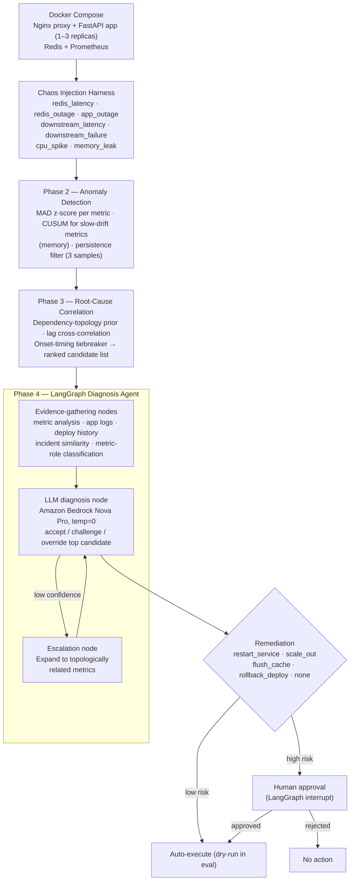

# Agentic AIOps Self-Healing System

A chaos-engineered incident response pipeline that detects anomalies in a live service, statistically ranks likely root causes, uses an LLM-driven LangGraph agent to reason over evidence and confirm or override the statistical diagnosis, and executes gated remediation.

Most AIOps demos stop at anomaly detection. This project goes further: given a detected anomaly, it identifies the most probable root cause using a deterministic statistical pipeline, hands that ranked hypothesis to an LLM agent for evidence-grounded reasoning, and only then decides on and executes a remediation action — with human approval required for any high-risk operation.

The system is deliberately layered so the hard quantitative work (detection and correlation) is handled by evaluated, explainable statistics, while the LLM's role is narrower: explain, challenge when evidence warrants it, and recommend action from a fixed, guarded action set. The LLM never invents a root cause from raw telemetry — it reasons over a hypothesis a tested pipeline already produced.

## Results at a glance

| Stage | Root-cause accuracy* |
|---|---|
| Naive (earliest-triggered metric) | 27% |
| Statistical pipeline (dependency prior + lag correlation + onset timing) | 70% |
| Statistical pipeline + LangGraph LLM reasoning | **80%** |

- Evaluated end-to-end on **10 self-injected chaos incidents** across 7 fault types (Redis latency/outage, app outage, downstream latency/failure, CPU spike, memory leak) — full ground truth known at injection time.
- The LLM layer correctly overrode a statistically-favored but wrong candidate in a recurring case (`downstream_latency_fdc80266`) by weighing correlation strength over a misleading onset signal — see the [case study](METHODOLOGY.md#case-study--correct-override-downstream_latency_fdc80266).
- All remediation guardrails held: no unsafe action ever recommended on latency-only evidence, no restart without availability/crash evidence, every high-risk action correctly gated for human approval.
- **One known, understood limitation**: a genuinely ambiguous incident (`cpu_spike`) with three closely-matched candidates is misdiagnosed by both layers — documented, not hidden.

*Sample-size caveat: 10-11 incidents means each one shifts reported accuracy by ~10 points. The comparative direction (naive → statistical → LLM-augmented) is the meaningful signal; treat the absolute percentages as indicative on this dataset, not precise real-world estimates. Full discussion in [METHODOLOGY.md](METHODOLOGY.md).*

## Demo

**Dashboard** — Grafana panel showing request latency, error rate, and Redis latency visibly responding during a live chaos fault injection. Shows the monitored system is a real running service with real telemetry, not synthetic data generated after the fact.


**Live remediation** — a non-dry-run pass of the full pipeline against live infrastructure: fault injection → detection → diagnosis → human approval prompt → actual `docker compose restart` executed and confirmed.


https://github.com/user-attachments/assets/4cfea308-10b8-42ea-9e40-c5ee535436eb

### Screenshots from the running demo

These screenshots are included here in the main README so you can understand what the live monitoring screens show without opening another document. The three screenshots supplied for this walkthrough are cropped to hide the public IP and AWS account header.

#### Prometheus confirms the app metrics target is reachable


Prometheus reports the `aiops-app` target as **1 / 1 up**. It scraped the app's `/metrics/` endpoint in about **4 ms**, on the configured **5-second** scrape interval. This confirms that Prometheus can collect metrics from the app; it does not by itself prove every API request is healthy or that an incident has been diagnosed.

#### Locust generates requests and shows request rate


Locust is the load generator, not the diagnosis agent. This snapshot shows a running test with **one virtual user**, about **0.8 requests per second**, and **0% failures**. A virtual user is a simulated client, not a real person.

#### Locust charts show response times and active users


The upper chart shows the 50th- and 95th-percentile response times. Most observations are low, with brief spikes close to **500 ms**. The lower chart shows the virtual-user count briefly falling to zero before returning to one. These graphs record what happened during this test; they do not identify the cause of a spike or pause. Check the app logs, Prometheus metrics, and chaos-experiment timestamps before attributing it to a fault.

#### Grafana visualizes service telemetry during experiments


This dashboard groups availability, dependency latency/errors, CPU, and memory signals. These are useful operational clues to investigate together; a chart changing is not, by itself, proof of root cause.


This dashboard shows request throughput, HTTP response counts, average and p95 request latency, Redis latency, and cache hits/misses/errors. During a controlled experiment, compare the timing of these signals with the injected fault and logs.

#### How the monitoring screenshots connect to diagnosis

```text
Locust traffic ──> Nginx proxy ──> FastAPI app ──> Redis / simulated dependency
                                      │
                                      └── /metrics ──> Prometheus ──> Grafana

Saved incident telemetry ──> detector ──> root-cause ranking
                                             └──> LangGraph / Bedrock
                                                   └──> remediation decision
```

The service and monitoring stack can run continuously, but the diagnosis evaluator is a separate command that replays saved incident telemetry. A Locust or Grafana chart changing does **not** automatically start a diagnosis or remediation. The agent may query Prometheus for evidence when a diagnosis run is explicitly started.

> **Security:** Prometheus, Locust, Grafana, and the chaos-control endpoints are demo tools and should not be left publicly reachable without appropriate protection. Prefer the private SSM port-forwarding workflow in the [Terraform guide](terraform/README.md); do not expose unauthenticated monitoring or fault-injection interfaces to the internet.


## Architecture

The diagram below shows the project at a glance. For the detailed code-mapped workflow, data handoffs, and runtime notes, see **[docs/ARCHITECTURE.md](docs/ARCHITECTURE.md)**.



For the detailed methodology behind each phase — detection formulas, correlation math, evidence-gathering design, and the full case studies — see **[METHODOLOGY.md](METHODOLOGY.md)**.

For a plain-English interview walkthrough, project Q&A, and step-by-step Ubuntu server deployment instructions, see **[INTERVIEW_AND_DEPLOYMENT_GUIDE.md](INTERVIEW_AND_DEPLOYMENT_GUIDE.md)**.

For a detailed code walkthrough, an explanation of the live monitoring screenshots, and the diagnosis evaluator output, see **[EXPLAINED_README.md](EXPLAINED_README.md)**.

For a cost-conscious AWS deployment using Terraform and a single EC2 instance, see **[terraform/README.md](terraform/README.md)**.

See **[ROADMAP.md](ROADMAP.md)** for the proposed next steps and longer-term direction.

## Components

- **Chaos harness** (`chaos/`) — Docker-based fault injectors for 7 fault types, each logging ground-truth timing and parameters to `chaos/incidents.log`.
- **Detectors** (`detector/mad_detector.py`, `detector/forecast_detector.py`) — per-metric anomaly detection with a CUSUM path for slow-drift metrics.
- **Root-cause pipeline** (`detector/rootcause/`) — event extraction, dependency-topology prior, lag correlation, ranking.
- **Diagnosis agent** (`agent/`) — LangGraph state machine: evidence-gathering nodes, escalation logic, LLM diagnosis node, remediation finalization and execution, human-approval interrupt.
- **Compose remediation** — high-risk `scale_out` adds a replica (up to three) behind an Nginx proxy; `rollback_deploy` restores the image preserved by the deployment script. Both require approval in the graph.
- **Deployment helpers** (`scripts/`) — health-checked image deployment with rollback preservation, bounded scale-out, and rollback history.
- **Evaluation harnesses** — `detector/evaluate.py` (detection), `detector/evaluate_rootcause.py` (correlation), `agent/evaluate_diagnosis.py` (full agent, end to end).
- **Infrastructure as code** (`terraform/`) — provisions a small EC2 host, private-by-default security group, encrypted storage, and SSM access for the Docker Compose demo.

## Tech Stack

Python, FastAPI, Redis, Prometheus, Docker Compose, LangGraph, Amazon Bedrock (Nova Pro), pandas, numpy.

## Running It

Grafana requires `GF_SECURITY_ADMIN_PASSWORD` in a local `.env` file in the project root. Compose loads this file automatically; the password is required and there is no default. Generate a unique password and protect the file with:

```bash
bash scripts/setup-env.sh
```

This command creates `.env` if it is missing, or adds the password if the file exists without one. If a password is already configured, it preserves it. Keep `.env` private; it is ignored by Git.

```bash
docker compose up --build -d
python3 -m chaos.run_experiments --fault redis_latency
python3 -m detector.evaluate
python3 -m detector.evaluate_rootcause
```

The full diagnosis evaluator requires the agent's Python dependencies, AWS Bedrock access, and a running local Prometheus instance. The evaluator auto-approves approval interrupts, so always run it with dry-run enabled.

The diagnosis executor defaults to dry-run. Run the evaluator safely with:

```bash
AIOPS_DRY_RUN=true python3 -m agent.evaluate_diagnosis
```

`agent.evaluate_diagnosis` automatically approves approval interrupts, so never set `AIOPS_DRY_RUN=false` for that evaluator. The Compose demo implements `scale_out` (one additional replica per action, maximum three) and `rollback_deploy` (restores the previous image recorded by `scripts/deploy-compose.sh`); both are high-risk and require approval in the interactive graph. See the full run-through in [INTERVIEW_AND_DEPLOYMENT_GUIDE.md](INTERVIEW_AND_DEPLOYMENT_GUIDE.md).

> **Safety note:** This is a single-host learning demo, not production autoscaling or a production rollback controller. The direct helper scripts change running containers; use them only on an isolated demo host.

## Known Limitations

- Root-cause ranking for faults producing closely-matched candidate signatures (see the `cpu_spike` case study in [METHODOLOGY.md](METHODOLOGY.md)) remains unresolved by both the statistical and LLM layers.
- Deploy-history and incident-history evidence nodes are validated against synthetic/self-logged data; a production deployment would integrate real CI/CD and incident-management systems.
- Ground-truth accuracy figures are measured against 10-11 self-injected incidents; a larger labeled set would tighten confidence in these numbers.
