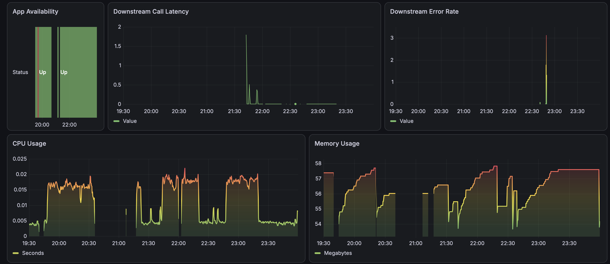
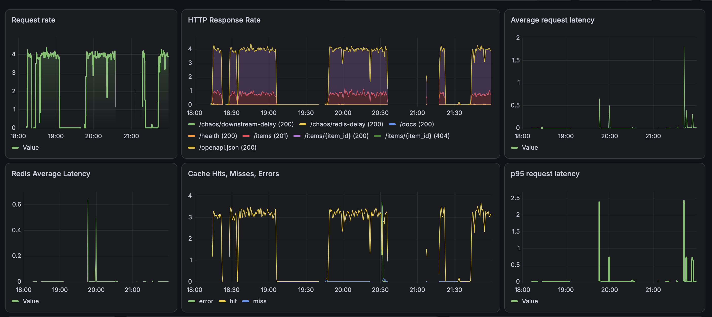
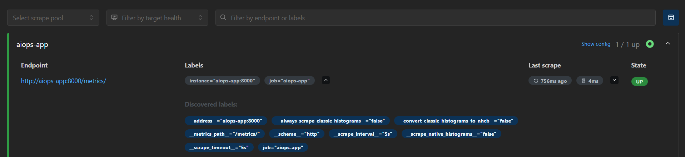
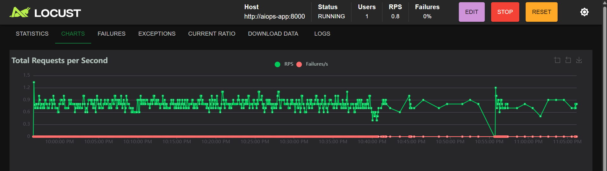
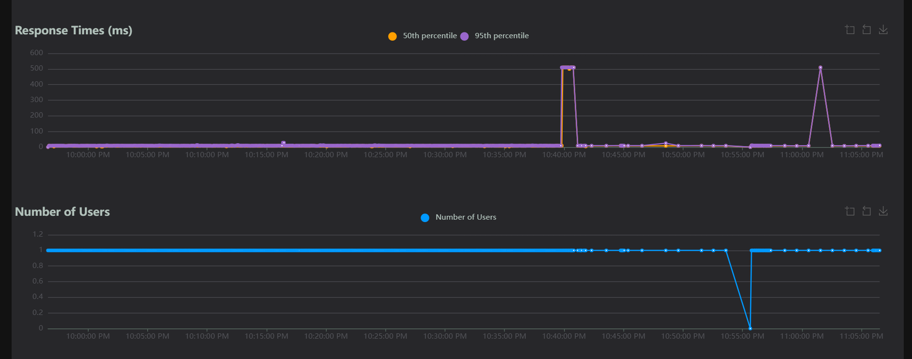
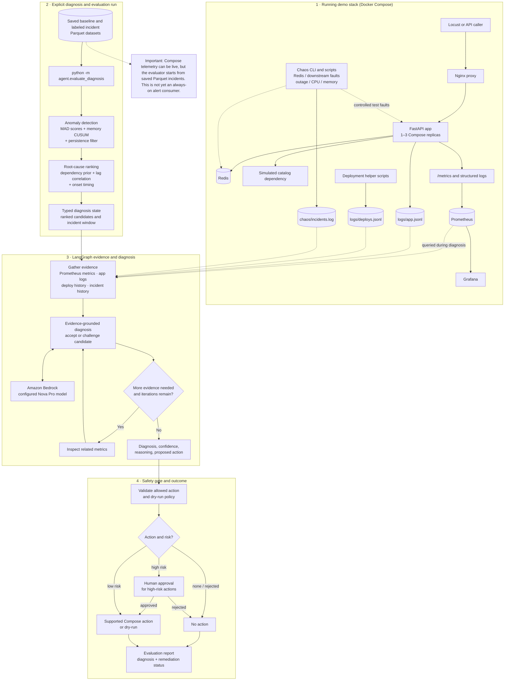

# Agentic AIOps Self-Healing System

A chaos-engineered incident response pipeline that detects anomalies in a live service, statistically ranks likely root causes, uses an LLM-driven LangGraph agent to reason over evidence and confirm or override the statistical diagnosis, and executes gated remediation.

Most AIOps demos stop at anomaly detection. This project goes further: given a detected anomaly, it identifies the most probable root cause using a deterministic statistical pipeline, hands that ranked hypothesis to an LLM agent for evidence-grounded reasoning, and only then decides on and executes a remediation action — with human approval required for any high-risk operation.

The system is deliberately layered so the hard quantitative work (detection and correlation) is handled by evaluated, explainable statistics, while the LLM's role is narrower: explain, challenge when evidence warrants it, and recommend action from a fixed, guarded action set. The LLM never invents a root cause from raw telemetry — it reasons over a hypothesis a tested pipeline already produced.

## Results at a glance

| Stage | Root-cause accuracy* |
|---|---|
| Naive (earliest-triggered metric) | 27% |
| Statistical pipeline (dependency prior + lag correlation + onset timing) | 70% |
| Statistical pipeline + LangGraph LLM reasoning | **80%** |

- Evaluated end-to-end on **10 self-injected chaos incidents** across 7 fault types (Redis latency/outage, app outage, downstream latency/failure, CPU spike, memory leak) — full ground truth known at injection time.
- The LLM layer correctly overrode a statistically-favored but wrong candidate in a recurring case (`downstream_latency_fdc80266`) by weighing correlation strength over a misleading onset signal — see the [case study](METHODOLOGY.md#case-study--correct-override-downstream_latency_fdc80266).
- Remediation guardrails are designed to avoid unsafe actions on latency-only evidence and require approval for high-risk actions in the interactive graph. In the evaluation harness, approval interrupts are automatically resumed and the run must remain in dry-run mode; this run did not demonstrate a human approving or executing a live repair.
- **Known limitations in the latest run**: the genuinely ambiguous `cpu_spike` incident and a `memory_leak` incident were both misdiagnosed. These errors are shown below rather than hidden.

*Sample-size caveat: 10-11 incidents means each one shifts reported accuracy by ~10 points. The comparative direction (naive → statistical → LLM-augmented) is the meaningful signal; treat the absolute percentages as indicative on this dataset, not precise real-world estimates. Full discussion in [METHODOLOGY.md](METHODOLOGY.md).*

### What the latest evaluation output means

The pasted run was started with `AIOPS_DRY_RUN=true python -m agent.evaluate_diagnosis`. It evaluated the labeled incidents from both the `train` and `test` folders. The unlabeled `memory_spike` file was explicitly skipped, so it is not included in the accuracy calculation.

| Incident | Expected root cause | Agent diagnosis | Result |
|---|---|---|---|
| `cpu_spike_52dcb84f` | `process_cpu_rate` | `redis_average_latency_seconds` | Incorrect; the signals were ambiguous |
| `downstream_failure_fd739d70` | `downstream_error_rate` | `downstream_error_rate` | Correct |
| `downstream_latency_a00e71c7` | `downstream_average_latency_seconds` | `downstream_average_latency_seconds` | Correct |
| `app_outage_9fc6ee70` | `app_availability` | `app_availability` | Correct |
| `downstream_latency_f222e70b` | `downstream_average_latency_seconds` | `downstream_average_latency_seconds` | Correct |
| `downstream_latency_fdc80266` | `downstream_average_latency_seconds` | `downstream_average_latency_seconds` | Correct override of the Phase 3 candidate |
| `memory_leak_35c25d43` | `process_resident_memory_bytes` | `downstream_average_latency_seconds` | Incorrect |
| `redis_latency_b50614d5` | `redis_average_latency_seconds` | `redis_average_latency_seconds` | Correct |
| `redis_outage_5742c596` | `redis_average_latency_seconds` | `redis_average_latency_seconds` | Correct |
| `redis_outage_8db2dfbc` | `redis_average_latency_seconds` | `redis_average_latency_seconds` | Correct |

In this run, **8 of 10 diagnoses were correct (80%)**. The agent changed its Phase 3 candidate twice; one override corrected the diagnosis (`downstream_latency_fdc80266`) and one did not (`cpu_spike`). Phase 3 agreement was also 80%: agreement means the LLM kept the statistical candidate, not necessarily that the diagnosis was correct. The memory leak remained misdiagnosed even though both stages chose the same downstream-latency candidate.

The average confidence was `0.572`. Treat this as the system's ranking score, **not** as a calibrated 57.2% probability. In this latest rerun, the agent asked for additional evidence in 4 of 10 cases, reached its three-iteration limit in 3 of 10, and averaged 1.70 iterations. Compared with the earlier captured run, the diagnosis outcomes and accuracy stayed the same; the iteration statistics changed. These values can vary between runs as LLM responses and live Prometheus evidence change.

**The remediation table is not evidence that this run performed a live repair.** The evaluator automatically resumes approval interruptions as `approved`; that is not a person approving an action. With dry-run enabled, the `app_outage` case's `restart_service` result was `dry_run`, and all other cases proposed `none`. No restart was carried out by this evaluation.

### If diagnosis fails with `JSONDecodeError: Extra data`

The deploy-history reader loads `logs/deploys.jsonl` as JSON Lines. Each line is intended to contain one JSON object, but a pasted traceback showed `Extra data` while parsing this file—evidence that at least one line had additional JSON text after its first object. The history reader now accepts multiple valid, directly concatenated JSON objects on a line, so these existing deploy events no longer abort the evaluation. If the file contains invalid JSON rather than concatenated valid objects, the error reports the file and line to help locate the bad entry. Keep new records newline-delimited; the deploy and rollback scripts already append a newline after each record.

To use the fix on the EC2 checkout, pull the updated repository before rerunning the evaluator:

```bash
cd ~/AIops-Agent
git pull
AIOPS_DRY_RUN=true python -m agent.evaluate_diagnosis
```

Keep dry-run enabled: the evaluator automatically resumes approval interrupts and is not an interactive human-approval session.

### What the Compose checks verified

The later `docker compose ps` output showed the app, Nginx proxy, Redis, Prometheus, Grafana, and Locust containers running. The scale test increased the FastAPI service from one to two Compose replicas, and both reported healthy. The rollback test switched both replicas back to the previously preserved image and again reported them healthy. These are single-host Compose checks, not AWS Auto Scaling or proof that the diagnosis evaluator triggered either operation.

The pasted command `curl -fsS http://http://34.235.132.35:8000/health` has a duplicated `http://`, so it is malformed and does not validate the public endpoint. A subsequent request to `http://127.0.0.1:8000/health` on the EC2 host returned `{"status":"healthy"}`, confirming the local health route after rollback. The Terraform deployment intentionally has no public inbound rules; use SSM port forwarding rather than exposing the app, Grafana, Prometheus, Locust, or unauthenticated chaos endpoints to the internet. See the [Terraform connection instructions](terraform/README.md).

### How to read the latest `/metrics` output

The pasted metrics snapshot is a Prometheus text-format scrape from **one FastAPI app process**. It records activity since that process started; it is not a time-bounded report or a cluster-wide total. Counters only increase until the process restarts, while histogram buckets are cumulative.

| Metric in the snapshot | Observed value | What it tells you |
|---|---:|---|
| `http_request_total{endpoint="/items/{item_id}",method="GET",http_status="200"}` | 111 | 111 successful item reads had been served by this process. |
| `http_request_total{endpoint="/items",method="POST",http_status="201"}` | 20 | 20 item-creation requests succeeded. |
| `http_request_total{endpoint="/health",method="GET",http_status="200"}` | 57 | 57 health checks succeeded. |
| `http_request_total{endpoint="/",method="GET",http_status="404"}` | 1 | The root request in this snapshot returned 404. This scrape predates deployment of the `/` information route added in this repository; rebuild/redeploy the app image before expecting `/` to return service information. |
| `http_request_duration_seconds` | GET item: 111 observations, ~0.735 s total; health: 57, ~0.049 s; POST item: 20, ~0.031 s | Dividing sum by count gives approximate averages of **6.62 ms**, **0.86 ms**, and **1.57 ms**, respectively. Histogram buckets show how many observations fell at or below each latency boundary. They are cumulative, so bucket values should not be added together. |
| `redis_request_duration_seconds` | GET: 111 observations, ~0.048 s total; SET: 20, ~0.009 s total | Approximate average Redis operation latency was **0.43 ms** for GET and **0.45 ms** for SET in this process. |
| `cache_request_total{outcome="hit"}` | 111 | All 111 recorded item reads were cache hits in this snapshot. No miss or error series appeared in the excerpt. |
| `downstream_calls_total{dependency="catalog-service",outcome="success"}` | 111 | The app recorded 111 successful calls to its simulated catalog dependency. |
| `downstream_call_duration_seconds` | 111 observations, ~0.587 s total | Approximate average downstream-call latency was **5.29 ms**. |
| `process_resident_memory_bytes` | ~56.4 MB | Resident memory (RAM) used by the scraped process at scrape time. |
| `process_virtual_memory_bytes` | ~142.1 MB | Virtual address-space size; this is not the same as RAM usage. |
| `process_cpu_seconds_total` | 1.69 s | Cumulative CPU time since the process started, not CPU percentage. Compare its rate over time to estimate current CPU use. |
| `process_open_fds` / `process_max_fds` | 12 / 1024 | Open file descriptors at scrape time versus the process limit. |
| `python_info` | CPython 3.11.17 | Runtime metadata for the process that produced this scrape. |

The shown request, cache, and dependency values look healthy for the observed sample, but one scrape cannot establish ongoing health or prove the system is free of incidents. Use Prometheus queries over time and compare application metrics with fault-injection timestamps. If the Compose service has multiple replicas, inspect the Prometheus target list and each target separately; this excerpt represents the responding process and should not automatically be read as the sum across replicas.

## Demo

**Dashboard** — Grafana panel showing request latency, error rate, and Redis latency visibly responding during a live chaos fault injection. Shows the monitored system is a real running service with real telemetry, not synthetic data generated after the fact.




**Live remediation** — a non-dry-run pass of the full pipeline against live infrastructure: fault injection → detection → diagnosis → human approval prompt → actual `docker compose restart` executed and confirmed.


https://github.com/user-attachments/assets/4cfea308-10b8-42ea-9e40-c5ee535436eb

### Screenshots from the running demo

These screenshots are included here in the main README so you can understand what the live monitoring screens show without opening another document. The three screenshots supplied for this walkthrough are cropped to hide the public IP and AWS account header.

#### Prometheus confirms the app metrics target is reachable



Prometheus reports the `aiops-app` target as **1 / 1 up**. It scraped the app's `/metrics/` endpoint in about **4 ms**, on the configured **5-second** scrape interval. This confirms that Prometheus can collect metrics from the app; it does not by itself prove every API request is healthy or that an incident has been diagnosed.

#### Locust generates requests and shows request rate



Locust is the load generator, not the diagnosis agent. This snapshot shows a running test with **one virtual user**, about **0.8 requests per second**, and **0% failures**. A virtual user is a simulated client, not a real person.

#### Locust charts show response times and active users



The upper chart shows the 50th- and 95th-percentile response times. Most observations are low, with brief spikes close to **500 ms**. The lower chart shows the virtual-user count briefly falling to zero before returning to one. These graphs record what happened during this test; they do not identify the cause of a spike or pause. Check the app logs, Prometheus metrics, and chaos-experiment timestamps before attributing it to a fault.

#### Grafana visualizes service telemetry during experiments


This dashboard groups availability, dependency latency/errors, CPU, and memory signals. These are useful operational clues to investigate together; a chart changing is not, by itself, proof of root cause.


This dashboard shows request throughput, HTTP response counts, average and p95 request latency, Redis latency, and cache hits/misses/errors. During a controlled experiment, compare the timing of these signals with the injected fault and logs.

#### How the monitoring screenshots connect to diagnosis

```text
Locust traffic ──> Nginx proxy ──> FastAPI app ──> Redis / simulated dependency
                                      │
                                      └── /metrics ──> Prometheus ──> Grafana

Saved incident telemetry ──> detector ──> root-cause ranking
                                             └──> LangGraph / Bedrock
                                                   └──> remediation decision
```

The service and monitoring stack can run continuously, but the diagnosis evaluator is a separate command that replays saved incident telemetry. A Locust or Grafana chart changing does **not** automatically start a diagnosis or remediation. The agent may query Prometheus for evidence when a diagnosis run is explicitly started.

> **Security:** Prometheus, Locust, Grafana, and the chaos-control endpoints are demo tools and should not be left publicly reachable without appropriate protection. Prefer the private SSM port-forwarding workflow in the [Terraform guide](terraform/README.md); do not expose unauthenticated monitoring or fault-injection interfaces to the internet.


## Architecture

The diagram separates the **running demo stack** from the **explicitly started diagnosis/evaluation workflow**. This distinction matters: changing a Grafana chart does not automatically start the agent. For the full interviewer-ready explanation, see **[INTERVIEW_PROJECT_WALKTHROUGH.md](INTERVIEW_PROJECT_WALKTHROUGH.md)**; for code-mapped details, see **[docs/ARCHITECTURE.md](docs/ARCHITECTURE.md)**.



### How to read this diagram

1. **The demo creates observable behavior.** Locust or a caller sends requests through Nginx to the FastAPI service, which uses Redis and a simulated dependency. Prometheus scrapes metrics; Grafana visualizes them. Chaos scripts inject controlled faults and record their metadata.
2. **The evaluator starts a separate diagnosis run.** `python -m agent.evaluate_diagnosis` reads saved baseline and labeled incident Parquet data. The detector identifies sustained metric anomalies using MAD-based scoring and a CUSUM path for gradual memory growth.
3. **The statistical pipeline ranks causes.** A dependency prior, lagged correlation, and onset timing rank candidate root causes before the LLM is involved.
4. **The LangGraph agent checks evidence.** It gathers metric summaries and nearby application, deployment, and incident history. Amazon Bedrock helps explain or challenge the statistical candidate using that evidence; it does not independently inspect all raw telemetry or directly control infrastructure.
5. **A safety boundary controls any action.** The workflow validates a restricted action set, defaults to dry-run, and pauses high-risk actions for approval in interactive runs. The evaluator itself auto-approves graph interrupts, so it must stay in dry-run mode.

The Compose `scale_out` action is a bounded **single-host demo operation** (up to three replicas), not AWS Auto Scaling or production autoscaling.

For the detailed methodology behind each phase — detection formulas, correlation math, evidence-gathering design, and the full case studies — see **[METHODOLOGY.md](METHODOLOGY.md)**.

For a plain-English interview walkthrough, project Q&A, and step-by-step Ubuntu server deployment instructions, see **[INTERVIEW_AND_DEPLOYMENT_GUIDE.md](INTERVIEW_AND_DEPLOYMENT_GUIDE.md)**.

For a first-person, start-to-finish presentation script you can use in an interview, see **[INTERVIEW_PROJECT_WALKTHROUGH.md](INTERVIEW_PROJECT_WALKTHROUGH.md)**.

For a detailed code walkthrough, an explanation of the live monitoring screenshots, and the diagnosis evaluator output, see **[EXPLAINED_README.md](EXPLAINED_README.md)**.

For a cost-conscious AWS deployment using Terraform and a single EC2 instance, see **[terraform/README.md](terraform/README.md)**.

See **[ROADMAP.md](ROADMAP.md)** for the proposed next steps and longer-term direction.

## Components

- **Chaos harness** (`chaos/`) — Docker-based fault injectors for 7 fault types, each logging ground-truth timing and parameters to `chaos/incidents.log`.
- **Detectors** (`detector/mad_detector.py`, `detector/forecast_detector.py`) — per-metric anomaly detection with a CUSUM path for slow-drift metrics.
- **Root-cause pipeline** (`detector/rootcause/`) — event extraction, dependency-topology prior, lag correlation, ranking.
- **Diagnosis agent** (`agent/`) — LangGraph state machine: evidence-gathering nodes, escalation logic, LLM diagnosis node, remediation finalization and execution, human-approval interrupt.
- **Compose remediation** — high-risk `scale_out` adds a replica (up to three) behind an Nginx proxy; `rollback_deploy` restores the image preserved by the deployment script. Both require approval in the graph.
- **Deployment helpers** (`scripts/`) — health-checked image deployment with rollback preservation, bounded scale-out, and rollback history.
- **Evaluation harnesses** — `detector/evaluate.py` (detection), `detector/evaluate_rootcause.py` (correlation), `agent/evaluate_diagnosis.py` (full agent, end to end).
- **Infrastructure as code** (`terraform/`) — provisions a small EC2 host, private-by-default security group, encrypted storage, and SSM access for the Docker Compose demo.

## Tech Stack

Python, FastAPI, Redis, Prometheus, Docker Compose, LangGraph, Amazon Bedrock (Nova Pro), pandas, numpy.

## Running It

Grafana requires `GF_SECURITY_ADMIN_PASSWORD` in a local `.env` file in the project root. Compose loads this file automatically; the password is required and there is no default. Generate a unique password and protect the file with:

```bash
bash scripts/setup-env.sh
```

This command creates `.env` if it is missing, or adds the password if the file exists without one. If a password is already configured, it preserves it. Keep `.env` private; it is ignored by Git.

```bash
docker compose up --build -d
python3 -m chaos.run_experiments --fault redis_latency
python3 -m detector.evaluate
python3 -m detector.evaluate_rootcause
```

The full diagnosis evaluator requires the agent's Python dependencies, AWS Bedrock access, and a running local Prometheus instance. The evaluator auto-approves approval interrupts, so always run it with dry-run enabled.

The diagnosis executor defaults to dry-run. Run the evaluator safely with:

```bash
AIOPS_DRY_RUN=true python3 -m agent.evaluate_diagnosis
```

`agent.evaluate_diagnosis` automatically approves approval interrupts, so never set `AIOPS_DRY_RUN=false` for that evaluator. The Compose demo implements `scale_out` (one additional replica per action, maximum three) and `rollback_deploy` (restores the previous image recorded by `scripts/deploy-compose.sh`); both are high-risk and require approval in the interactive graph. See the full run-through in [INTERVIEW_AND_DEPLOYMENT_GUIDE.md](INTERVIEW_AND_DEPLOYMENT_GUIDE.md).

> **Safety note:** This is a single-host learning demo, not production autoscaling or a production rollback controller. The direct helper scripts change running containers; use them only on an isolated demo host.

## Known Limitations

- Root-cause ranking for faults producing closely-matched candidate signatures (see the `cpu_spike` case study in [METHODOLOGY.md](METHODOLOGY.md)) remains unresolved by both the statistical and LLM layers.
- Deploy-history and incident-history evidence nodes are validated against synthetic/self-logged data; a production deployment would integrate real CI/CD and incident-management systems.
- Ground-truth accuracy figures are measured against 10-11 self-injected incidents; a larger labeled set would tighten confidence in these numbers.
