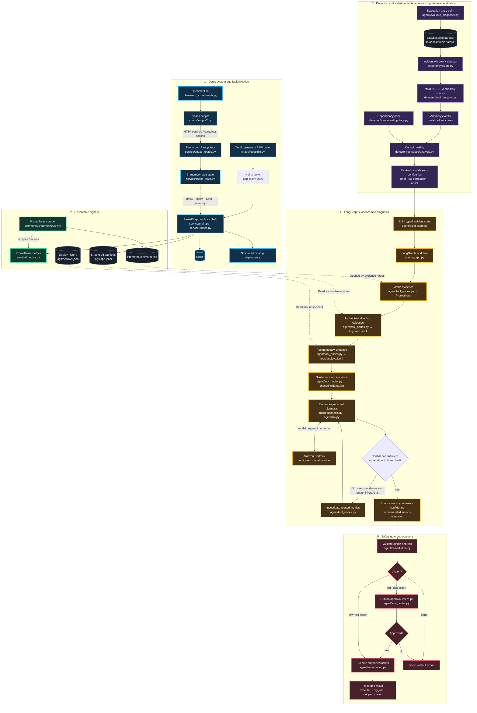

# Project Architecture and Runtime Flow

This page follows the project from a fault being injected into the demo service to the final diagnosis and remediation decision. The diagrams map each stage to the code that implements it.

> **Important runtime distinction:** the service, Prometheus, and fault injectors can run continuously in Docker Compose. The current detector-to-agent diagnosis path is an evaluation workflow over saved Parquet baseline/incident data; it is not yet an always-on alert consumer. `agent/evaluate_diagnosis.py` builds the diagnosis state from a dataset, then invokes the LangGraph agent, whose evidence nodes query live Prometheus and local logs.

## End-to-end architecture



## Runtime walkthrough

The expected evaluation path, from the repository root, is:

```text
python -m agent.evaluate_diagnosis
    ├─ Read baseline and labeled incident Parquet files
    ├─ detector/evaluate.py
    │    └─ detector/mad_detector.py: score metrics and emit sustained anomaly flags
    ├─ agent/build_state.py
    │    └─ detector/rootcause/analysis.py + topology.py: extract and rank candidate causes
    ├─ agent/graph.py
    │    ├─ Gather metric, log, deploy, and incident-history evidence
    │    ├─ agent/diagnosis.py → agent/llm.py → configured LLM provider
    │    ├─ If uncertain: inspect related metrics and diagnose again (up to 3 attempts)
    │    └─ Finalize action → approval interrupt if high risk → supported executor
    └─ Print diagnosis, evaluation result, and remediation status
```

The service's telemetry and Prometheus are live inputs for evidence collection, but the **initial alert and ranked candidate list are currently built from saved incident datasets** by the evaluation harness. A future always-on workflow would connect live Prometheus alerting to the same state-building and diagnosis stages.

## What each stage passes forward

| Stage | Input | Output | Main code |
|---|---|---|---|
| Fault injection | Fault type and parameters | Fault state, timing, and ground-truth incident record | `chaos/run_experiments.py`, `chaos/scripts/`, `service/chaos_routes.py` |
| Service telemetry | API requests and active fault state | Prometheus metrics and structured logs | `service/routes.py`, `service/metrics.py`, `service/logger.py` |
| Detection | Baseline plus incident time series | Per-metric scores and persistent anomaly flags | `detector/evaluate.py`, `detector/mad_detector.py` |
| Candidate ranking | Anomaly events and aligned metric window | Ordered root-cause candidates with confidence features | `detector/rootcause/analysis.py`, `detector/rootcause/topology.py` |
| State construction | Candidate list and incident window | Typed `DiagnosisState` for the graph | `agent/build_state.py`, `agent/state.py` |
| Evidence gathering | Diagnosis state and incident time window | Metric summaries, app logs, deploy history, similar incidents | `agent/tool_nodes.py`, `agent/utils.py` |
| LLM diagnosis | Ranked candidates plus gathered evidence | Hypothesis, root cause, confidence, action, reasoning | `agent/diagnosis.py`, `agent/llm.py`, `agent/utils.py` |
| Safety and remediation | Recommended action and diagnosis state | Approval pause, no-op, or action result | `agent/remediation.py`, `agent/tool_nodes.py`, `agent/graph.py` |

## Remediation boundary

The Compose demo implements `scale_out` by adding one `aiops-app` replica behind the Nginx proxy, with a maximum of three replicas. `rollback_deploy` restores the prior image tagged by `scripts/deploy-compose.sh` and requires recent deployment evidence. Both actions are high-risk and require approval in the interactive graph. Remediation defaults to dry-run through `AIOPS_DRY_RUN=true`; the diagnosis evaluator still auto-approves approval interrupts, so never run that evaluator with live remediation enabled. The app image deploy, scale, and rollback scripts are documented in the end-to-end [deployment guide](../INTERVIEW_AND_DEPLOYMENT_GUIDE.md).

These actions are single-host Compose demonstrations, not production autoscaling or a production rollback controller. The deployment history is a local JSONL file, and helper scripts invoked directly do not add a separate confirmation prompt.

The chaos endpoints are also unauthenticated. Keep them isolated; do not expose them or the demo dashboards directly to the public internet.

## Related documentation

- [README.md](../README.md) — project overview and results.
- [METHODOLOGY.md](../METHODOLOGY.md) — detector, ranking, and evaluation details.
- [INTERVIEW_AND_DEPLOYMENT_GUIDE.md](../INTERVIEW_AND_DEPLOYMENT_GUIDE.md) — walkthrough and deployment guide.
- [ROADMAP.md](../ROADMAP.md) — proposed future work.
- [terraform/README.md](../terraform/README.md) — cost-conscious AWS demo deployment.
